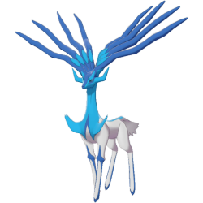
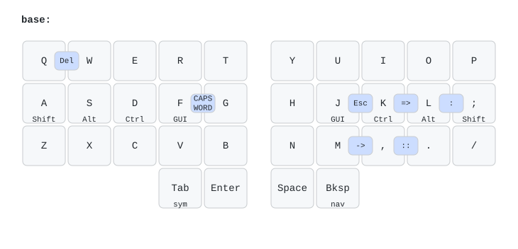

# Xerneas


My ZMK config for a Sweep Bling LP (34 keys). Shoutout KeebMaker.

QWERTY with home-row mods, set up for C++ and Rust with some TS/React on the side. Firmware is built by the GitHub Action on every push.

## Layers

Home-row mods are A/; Shift, S/L Alt, D/K Ctrl and F/J GUI. A mod only kicks in when held with a key on the other hand, so same-hand rolls stay as letters. The small labels under the keys show the hold action, and the blue pills are combos.

### Base


### SYM
Hold the left outer thumb.



### NAV
Hold the right outer thumb. The mods on the left home row are plain keys, so Shift/Ctrl + arrows work.



### NUM
Hold SYM and NAV together.



### SYS
Reset, bootloader, Bluetooth select/clear and the Studio unlock key. Reached from the bottom-right key of NAV.



## Combos
Base layer only.

- J + K: Esc
- L + ;: :
- , + .: ::
- M + ,: ->
- K + L: =>
- F + G: Caps Word
- Q + W: Del

## Drawings
The images in `keymap-drawer/` come from [keymap-drawer](https://github.com/caksoylar/keymap-drawer). To regenerate them after a keymap change, run this from that folder:

```
keymap -c keymap_drawer.config.yaml parse -z ../config/cradio.keymap -o cradio.yaml
keymap -c keymap_drawer.config.yaml draw --ortho-layout '{"split": true, "rows": 3, "columns": 5, "thumbs": 2}' -o cradio-base.svg cradio.yaml -s base
```

Change `base` and the output name for the other layers.
